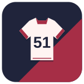

# 山口航輝

**日本 #51 · 內野手 · 26 歲 · 右投右打**

YAMAGUCHI KOKI

- **所屬球隊**　千葉羅德海洋（亞冠大會名單所列）。 [大會名單](https://www.japan-baseball.jp/jp/games/apbc2026/player_jpn.html)
- **出生日期**　2000-08-18，年齡以 2026-11-12 計。 [生日原始核對](https://www.japan-baseball.jp/jp/profile/202611015.html)
- **身高／體重**　183 cm／100 kg。 [登錄資料](https://www.japan-baseball.jp/jp/profile/202611015.html)

[台日戰](../../games/2026-11-12-tpe-jpn.md) · [官方球員頁](https://www.japan-baseball.jp/jp/profile/202611015.html) · [PNG 轉播素材](../../../assets/apbc-2026/jpn/51.png)

## 棒球經歷

- 明桜高。2018 年選秀第 4 指名。 [NPB 球員頁](https://npb.jp/bis/players/91895138.html)
- 2026 日職一軍例行賽 · 113 場、447 打席、114 支安打、38 支全壘打、0 次盜壘成功，打擊率／上壘率／長打率 .277／.329／.602。 [NPB 球員頁](https://npb.jp/bis/players/91895138.html)

## 播報備註

- **獎項**　2026 年 8 月太平洋聯盟再見獎。8 月 26 日對軟銀在延長十局下擊出再見全壘打。 [NPB 公告](https://npb.jp/award/2026/sayonara/win_8.html)
